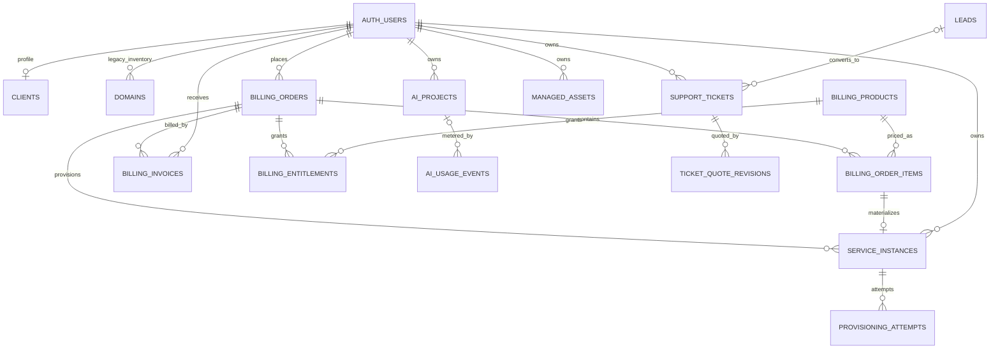

# HostSuite Database Relationships and Security Audit

**Status:** Read-only technical audit; remediation specification  
**Audited baseline:** `staging` at `2df2279e42dbf0c14d825e38d851ed2ea4014ab8`  
**Audit branch:** `docs/unified-platform-architecture`  
**PR #58 overlay reviewed:** `feat/hostsuite-customer-care-lifecycle` at `c8314223eb4363e73c2c5b9b7b5286a6f15f8e3c`  
**Important:** PR #58 is still draft and its SQL migrations are not part of staging. This document distinguishes deployed-to-branch baseline from proposed PR changes. No database was queried and no migration was executed; findings are from source/migration inspection, not live Supabase catalog inspection.

## 1. Executive assessment

HostSuite already has the beginnings of a coherent shared platform: Supabase Auth, a commercial ledger, entitlements, provisioned service instances, external managed assets, support tickets, AI projects and provider adapters. The architecture does not need a second portal, second billing engine or replacement customer identity.

The technical foundation is **not yet safe to treat as production-ready**. The highest-priority work is:

1. Fix a PostgreSQL function delimiter syntax error in PR #58 before any attempt to apply its migration set.
2. Replace cookie-session-only admin authorization with verified user/role authorization before any API handler uses the service-role client.
3. Restrict execution of the SECURITY DEFINER billing entitlement function to trusted server execution.
4. Remove customer write access to the legacy `domains` table as a source of operational truth; customers can currently write operational-looking status fields.
5. Add database-side guards to public lead and customer ticket creation. PR #58 proposes these, but they are not on staging.
6. Stop exposing every column of active `billing_products` rows to anonymous users; publish a deliberately allow-listed catalogue projection.
7. Do not represent subscription rows with `auto_renew=true` as a functioning recurring billing system.

The core ownership model remains:

- `auth.users` is the canonical identity.
- `leads` is pre-account/pre-ticket intake.
- `support_tickets` is customer work/request history.
- `billing_orders` and `billing_invoices` are commercial records.
- `billing_entitlements` is purchased value/permission.
- `service_instances` is the operational record for services HostSuite sells/provisions.
- `managed_assets` is the operational record for customer-owned/external services HostSuite manages.
- AI projects are customer-owned workspaces; a published deployment still needs a durable asset/service link.

## 2. Migration history reviewed

The staging tree contains these migrations, in repository order:

| Migration | Main effect |
|---|---|
| `20260802063017_create_hostsuite_schema.sql` | `leads`, legacy `domains`, initial `support_tickets`, initial owner/public policies |
| `20260803044537_create_admin_content_schema.sql` | `is_admin()`, `clients`, blogs, knowledge base, site settings, ticket staff fields and admin policies |
| `20260803045201_create_storage_bucket.sql` | Storage bucket setup |
| `20260803061241_20260803060000_tighten_rls_policies.sql.sql` | Replaces broad lead access; adjusts clients/domains/ticket policies |
| `20260901120000_create_flexible_billing.sql` | Products, orders, order items, invoices, subscriptions, usage, webhook ledger |
| `20260901121500_add_billing_entitlements.sql` | Entitlements and `grant_billing_order_value()` |
| `20260901133000_create_pricing_engine.sql` | Price versions, promotions, credit ledger, referrals, tax and payment fee rules |
| `20260901150000_create_ai_usage.sql` | AI projects, usage events and credit packs |
| `20260903090000_create_service_instances.sql` | Purchased/provisioned service instances and order conversion function |
| `20260903093000_create_provisioning_attempts.sql` | Provisioning attempt history and attempt-number helper |
| `20260903094500_add_provisioning_start_transaction.sql` | Atomic provisioning-start transition |
| `20260903100000_create_customer_order_rpc.sql` | Server-calculated single-product customer order RPC |
| `20260903100000_harden_service_provisioning_functions.sql` | Restricts provisioning RPC execution to service role |
| `20260903110000_add_admin_operations_policies.sql` | Admin operational access to services and billing records |
| `20260903113000_create_managed_assets.sql` | Customer-owned/external asset inventory |
| `20261104090000_lock_ai_project_writes.sql` | Changes AI project policy from customer CRUD to owner/admin read; writes become server-owned |

### PR #58 migrations reviewed separately (not on staging)

- `20261108160000_customer_care_ticket_lifecycle.sql`
- `20261108180000_ticket_quote_revisions_and_settlement.sql`

PR #58 is draft/open. Its proposed schema, policies, triggers and webhook changes are not evidence of the current staging database state. The source migrations also have not been executed in Supabase.

## 3. Relationship map

The last relationship, `ticket_quote_revisions`, exists only in the PR #58 proposal. The diagram describes logical relationships; it does not imply every relationship is currently enforced by a foreign key.

## 4. Table-by-table ownership and access matrix

Actor shorthand:
- **Anon:** unauthenticated Supabase `anon` role.
- **Customer:** authenticated user acting through the customer account.
- **Admin:** current single-email administrator identity.
- **Service role:** trusted server-side Supabase service key; bypasses RLS.
- **Staff:** no independent staff role/role table was found in the reviewed migrations. Treating all staff as a separate actor is a required future capability, not an existing permission tier.

| Table | Primary key / owner | Important relationships | Staging RLS/access | Recommended canonical use |
|---|---|---|---|---|
| `clients` | `id = auth.users.id` | One-to-one auth profile | Customer select/update own; customer insert own after tightening; admin full access | Optional business/contact profile, never a second identity |
| `leads` | `id`; no owner column in staging | PR #58 adds `linked_user_id → auth.users` | Anon/customer insert; admin select/update/delete after tightening | Intake record; preserve after conversion |
| `domains` | `id`, `user_id` | `user_id → auth.users` | Original customer CRUD policies remain; admin policies also exist | Legacy inventory only; do not trust it for real provider status |
| `support_tickets` | `id`, `user_id` | `user_id → auth.users`; PR #58 adds `lead_id → leads`, `billing_order_id → billing_orders` | Customer select/insert own; customer update/delete removed by tightening; admin select/update/insert/delete | Canonical request/work record |
| `blogs` | `id` | None | Public read of published content; admin writes | Public CMS content |
| `knowledge_base` | `id` | None | Public read of published content; admin writes | Public support content |
| `site_settings` | `key` | None | Public read all rows; admin writes | Public configuration only; never store secrets |
| `billing_products` | `id` | Referenced by price versions, order items, subscriptions, entitlements, usage | Public read of active rows; server/service role writes | Shared catalogue; public projection must hide internal metadata |
| `billing_orders` | `id`, `user_id` | `user_id → auth.users`; quote order metadata in PR #58 | Customer read own; admin full; server/service role writes | Commercial transaction source of truth |
| `billing_order_items` | `id`, parent `order_id` | `order_id → billing_orders`; `product_id → billing_products` | Customer read via parent order; admin full; server writes | Immutable purchased line snapshot |
| `billing_invoices` | `id`, `user_id` | `user_id → auth.users`; `order_id → billing_orders` | Customer read own; admin full; server writes | Invoice ledger |
| `billing_subscriptions` | `id`, `user_id` | User and optional product | Customer read own; admin full; server writes | Subscription contract/coverage record; not proof of recurring collection |
| `billing_usage` | `id`, `user_id` | User and optional product | Customer read own; admin read; server writes | Usage metering ledger |
| `billing_webhook_events` | `id`; unique `provider,event_id` | Logical relation to provider transaction/order | Admin read; no customer access; server writes | Provider event audit/idempotency ledger |
| `billing_entitlements` | `id`, `user_id` | User, product, order | Customer read own; no explicit admin RLS policy; service role writes | Purchased rights/value, separate from service lifecycle |
| `billing_price_versions` | `id` | `product_id → billing_products`; optional creator | Admin only; server writes | Historical retail/supplier economics |
| `billing_promotions` | `id` | Used by order promotion reference | Admin only; server evaluates | Promotion rules |
| `billing_credit_ledger` | `id`, `user_id` | User, optional creator | Owner/admin read; admin insert; server writes | Append-only credit ledger; add explicit reversal entries |
| `billing_referrals` | `id`, referrer/referred IDs | Users and optional qualifying order | Referrer/referred/admin read; admin manage | Referral history |
| `billing_tax_rules` | `id` | None | Admin only; server evaluates | Internal tax configuration |
| `billing_payment_fee_rules` | `id` | None | Admin only; server evaluates | Internal payment cost configuration |
| `ai_projects` | `id`, `user_id` | `user_id → auth.users` | Current staging: owner/admin SELECT only; server role writes | Customer AI project and generation state |
| `ai_usage_events` | `id`, `user_id` | User, optional project | Owner/admin read; admin insert; service role writes | AI usage/cost ledger |
| `ai_credit_packs` | `id` | None | Authenticated read active; admin manage | AI credit catalogue |
| `service_instances` | `id`, `user_id` | User, order, order item, optional product | Customer read own; admin full; service role lifecycle writes | Canonical HostSuite-sold/provisioned service |
| `provisioning_attempts` | `id`, `service_instance_id` | `service_instance_id → service_instances` | Customer read through owned instance; admin read; service role writes | Provisioning execution history |
| `managed_assets` | `id`, `user_id` | User | Customer read own; API/service role writes; no customer direct writes | Customer-owned/external asset under management |
| `ticket_quote_revisions` | `id`, `ticket_id` | PR #58: `ticket_id → support_tickets`, optional creator | PR #58: authenticated read own/admin; writes service-role only | Immutable quote history, if PR #58 is repaired/reviewed |

### Important RLS interpretation

PostgreSQL's default permissive policies combine with **OR**, not replacement semantics. A later `CREATE POLICY` does not cancel an earlier policy. Only explicitly dropped policies are removed. The audit therefore evaluated the cumulative migration chain, not just the final migration's new policy statements.

The current staging policies do not define a first-class **staff** actor. The effective model is customer, one email-based admin, anon and service-role. That is insufficient for a growing managed-service operation with support, finance, engineering and read-only reviewer duties.

## 5. Confirmed high-priority findings

### SEC-01 — Admin API authorization trusts `getSession()` instead of verified identity
**Severity: Critical / fix before relying on admin endpoints**

`lib/supabase-server.ts` implements `verifyAdmin()` by reading `auth.getSession()` and comparing the session user's email to a hardcoded address. Session data read from cookies is not the right authorization proof for server-side privileged actions. Multiple admin APIs then create/use the service-role client after this check.

**Required correction**
- Verify the request identity with `auth.getUser()` on the server.
- Resolve an explicit trusted role/permission from a server-controlled source (prefer a role table or signed custom claim), not a client-editable profile field.
- Apply the same shared guard to every admin route and server action.
- Add negative tests for forged/expired cookies, normal customers, missing sessions and staff role boundaries.
- Keep service-role client imports in server-only modules and prohibit importing them into client bundles.

### SEC-02 — SECURITY DEFINER entitlement function is not restricted
**Severity: High**

`grant_billing_order_value(uuid)` is declared SECURITY DEFINER in `20260901121500_add_billing_entitlements.sql`, but the reviewed migration does not revoke default PUBLIC execution or grant it only to `service_role`. PostgreSQL functions commonly receive EXECUTE for PUBLIC by default unless revoked.

**Required correction**
- Revoke EXECUTE from PUBLIC, anon and authenticated.
- Grant EXECUTE only to service_role.
- Audit every SECURITY DEFINER function for fixed `search_path`, strict input validation, ownership/state checks and explicit grants.
- Add a test proving authenticated callers cannot execute the function directly.

### SEC-03 — Legacy `domains` table permits customers to write operational status
**Severity: High**

The original owner-scoped CRUD policies on `domains` remain after the tightening migration. The table contains fields such as `ssl_active`, `last_backup` and `uptime_pct`. A customer can create/update their own rows and set those values, even though those values look like measured infrastructure state.

**Required correction**
- Stop using `domains` as authoritative operational state.
- Make customer writes go through a validated server workflow or retire direct customer insert/update/delete policies.
- Use `service_instances` for HostSuite-purchased domains and provider-sourced status.
- Keep a compatibility read/one-time migration path for existing legacy rows; do not silently delete customer inventory.
- Never display a backup/uptime/SSL claim without a provider/check result and timestamp.

### SEC-04 — Public ticket and lead inserts can forge staff-owned state on staging
**Severity: High; PR #58 proposes the needed guard, but it is not yet on staging**

The tightened lead policy allows anonymous inserts and does not, in staging, force `status='new'`. A caller can submit a lead with a fabricated `won`/other status. The customer ticket insert policy is owner-scoped, but RLS checks only the owner ID; it does not prevent a customer from inserting staff-looking fields such as a resolved status or internal notes.

PR #58 adds BEFORE INSERT triggers to normalize public lead conversion fields and customer ticket staff fields, and removes customer ticket update/delete policies. Those changes are not active on staging until the SQL is repaired, reviewed and applied.

**Required correction**
- Retain public lead insertion, but force all staff-owned fields to safe defaults in the database.
- Retain customer ticket creation/read, but force initial status, quote state, conversion IDs, billing links, resolution fields and internal notes to safe defaults.
- Ensure only trusted server functions/admin routes can change quote, assignment, internal notes, resolution and payment fields.
- Test direct Supabase Data API writes, not just the web forms.

### SEC-05 — Active product rows are public at the table level
**Severity: High**

`billing_products` has a public SELECT policy for active rows. RLS filters rows, not individual columns. The table also contains `metadata jsonb`, which is used by provider/provisioning code for internal plan references and may contain supplier/provider configuration.

**Required correction**
- Expose public catalogue data through a restricted view or server API that returns only name, public description, product type, public price, currency, billing mode, interval and safe public metadata.
- Keep provider plan references, supplier costs, margin, credentials and operational metadata server-only.
- Audit every public CMS/config table for accidentally stored secrets or internal configuration.

### SEC-06 — Admin identity is hardcoded to one email
**Severity: High architectural constraint**

`public.is_admin()` and application-level admin checks are coupled to one email address. This is not a durable staff access model and does not support least-privilege roles.

**Required correction**
- Introduce server-controlled roles/permissions keyed by auth user ID, e.g. owner/admin, operations, support, finance, engineering and read-only.
- Make role changes auditable and require explicit authorization for high-impact actions.
- Keep customer profile fields separate from authorization data.
- Migrate the current administrator into the new role model without changing account identity.

### BILL-01 — Subscription records are created without a recurring collection system
**Severity: High product and financial correctness issue**

`grant_billing_order_value()` creates a `billing_subscriptions` row for subscription products and sets `auto_renew=true` with a future `next_billing_at`. The reviewed schema does not contain a complete provider authorization/token lifecycle, and the reviewed application routes do not demonstrate scheduled automatic charges, retries, dunning, cancellation or renewal reconciliation.

**Required correction**
- Treat the current row as a subscription/coverage record only; do not claim auto-renewal is operational.
- Do not set `auto_renew=true` until the customer has explicitly consented and a provider authorization is securely stored.
- Implement a scheduled collection worker, idempotent charge attempts, failure/retry policy, notifications, cancellation and renewal events.
- Separate care coverage status from payment collection status.

### BILL-02 — Ticket quote SQL in PR #58 contains an invalid dollar-quote delimiter
**Severity: Critical migration blocker**

In `20261108180000_ticket_quote_revisions_and_settlement.sql`, the function `convert_diagnostic_lead_to_ticket_with_quote` is opened with `AS $` and closed with `$;`, unlike valid PostgreSQL dollar-quoted bodies using `$$ ... $$;`. The single-dollar delimiter is not a valid empty dollar-quote delimiter. This migration should fail to parse at that function.

**Required correction**
- Replace the opening/closing delimiter with a matching valid delimiter such as `$$`.
- Run the complete migration set against a disposable Supabase/PostgreSQL database before any real project application.
- Add migration execution to CI; typecheck/build does not validate SQL.
- Re-fetch the exact PR head and confirm no concurrent edit changed the migration before fixing it.

### BILL-03 — Ticket checkout can reopen terminal billing orders
**Severity: High / review before PR #58 approval**

The PR #58 ticket checkout route changes any existing non-paid, non-pending quote order back to `pending`. This includes statuses such as `cancelled` or `refunded`, not only retryable `failed` orders. Reusing the same provider reference after a terminal outcome can make the financial history ambiguous.

**Required correction**
- Define explicit retryable states.
- Permit retry only from a documented retryable state (typically failed/expired), with a fresh provider reference or a clearly documented same-reference policy.
- Never silently reopen refunded/cancelled orders.
- Add tests for pending, failed, cancelled, refunded, paid and stale-quote orders.

### BILL-04 — Webhook event claiming is not a single atomic claim operation
**Severity: Medium**

The webhook handlers read `processed`, then upsert the event, then process the order. Concurrent deliveries can both observe an unprocessed event before either marks it complete. Quote settlement has row locks and the generic order/provisioning functions have some idempotency protections, but the event ledger itself is not an atomic claim/lease.

**Required correction**
- Add a database-side claim function or state transition that atomically claims an event with a processing lease.
- Ensure order settlement is conditional on `status='pending'` and is idempotent.
- Record failed processing and allow safe retry; do not mark events processed before all required durable effects complete.
- Test duplicate and concurrent webhook deliveries for both providers.

### OPS-01 — Public lead rate limiting is process-local
**Severity: Medium**

`app/api/leads/route.ts` stores IP hits in a module-level JavaScript Map. This is not shared across serverless instances, can reset on cold starts and is not a durable abuse-control boundary. The route also relies on forwarded IP headers.

**Required correction**
- Use edge/WAF rate limiting and a persistent limiter or challenge such as Turnstile where appropriate.
- Trust only platform-controlled client IP headers.
- Add payload size limits, source allow-lists, email/URL validation and alerting for abuse.
- Keep the public diagnostic/WhatsApp journey; hardening must not force account creation before a customer can ask for help.

## 6. Additional data-model observations

### Legacy domains versus purchased services
`domains` and `service_instances` overlap conceptually. New purchases should create an order, entitlement where applicable, and service instance. A purchased domain should not also be independently inserted into `domains` as a second authoritative record. If the portal needs a unified display, create a read model/view/API that maps legacy domains and domain service instances while retaining source identity.

### Purchased service instances versus managed assets
This split is correct and should remain:
- `service_instances`: HostSuite has sold/provisioned the service; order and order-item provenance exists.
- `managed_assets`: customer brings an existing external service; it may be hosted elsewhere and is not evidence of a HostSuite sale.

Add asset verification/ownership evidence and avoid storing provider passwords/API credentials in `details jsonb`. Use a secrets vault/provider connection model for credentials.

### Tickets and customer work history
PR #58 improves one-off work with lead linkage and immutable quote revisions. It still does not provide a full ticket event/audit stream, staff assignment, customer-visible progress updates, delivery evidence or a structured closure record. Add these as separate append-only ticket events/deliverables rather than continuously overwriting the ticket row. Do not turn each ticket into a subscription.

### Quote history retention
PR #58 defines `ticket_quote_revisions.ticket_id ON DELETE CASCADE`. This means deleting a ticket also deletes its quote history. For financial/audit records, prefer soft deletion/retention controls or a restrictive FK so quote evidence cannot disappear through ordinary ticket deletion.

### Managed assets
The current `managed_assets` table has owner-scoped reads and server-owned writes, which is appropriate. The API currently supports creation and listing; a full lifecycle still needs validated update, archive, ownership verification, service notes and an auditable management-mode change. Add a uniqueness/idempotency strategy for duplicate assets where business rules permit it.

### Service instance lifecycle
The current design correctly separates payment from provisioning and uses `provisioning_attempts`. Keep these states distinct:
- commercial: pending/paid/refunded;
- entitlement: active/exhausted/expired/revoked;
- operational: pending_payment/paid/provisioning/active/provisioning_failed/suspended/cancelled.

Do not mark a service active merely because payment succeeded. Provider success and persisted provider resource identifiers must be confirmed first. Provisioning retries must be safe against duplicate external provider operations.

### AI project lifecycle
The latest staging migration intentionally makes AI projects customer-readable and server-write-owned. The API routes authenticate the bearer token, scope project reads/writes by `user_id`, and use the service-role client for writes. This is the right direction, but continue testing every route for IDOR and ensure generated output, provider data and deployment secrets are never exposed across projects. A successful generated draft is not yet a published website service.

### Profile and customer identity
`clients.id` is already a one-to-one auth user ID. Do not add a second customer table with a separate UUID identity. If organisations/teams are introduced later, model organisation membership explicitly and decide whether assets/orders are individually or organisation-owned; do not retrofit by matching email addresses.

## 7. API and service-role call-site review

| Surface | Observed pattern | Audit result |
|---|---|---|
| `lib/supabase-admin.ts` | Server-only factory for service-role client | Correct separation by convention; enforce server-only imports and secret scanning |
| `lib/supabase-server.ts` | Cookie-backed anon client; `verifyAdmin()` currently checks `getSession()` | Admin guard needs verified identity and role model |
| `app/api/leads` | Public POST validates/sanitizes, writes via service role, sends notification | Preserve flow; process-local rate limit and DB-side status guard need hardening |
| `app/api/managed-assets` | Verifies bearer token with `auth.getUser()`; scopes rows to user ID; service-role write | Ownership pattern is sound; add lifecycle endpoints and input/secret validation |
| `app/api/domains/manage` | Verifies user and scopes service instance by ID + owner + type before provider call | Good ownership pattern; provider action audit/rate limits still needed |
| `app/api/billing/*/initialize` | Resolves authenticated user, reads active products, calculates server-side total, writes order/items/invoice | Good server-side price principle; consolidate duplicate provider initialization paths and test rollback on partial writes |
| `app/api/billing/*/webhook` | Validates provider signature and verifies transaction/reference/amount/currency | Good baseline; atomic event claiming and complete reconciliation tests needed |
| `app/api/services/[id]/provision` | Verifies user and checks instance ownership before provisioning | Good ownership check; keep provider operations idempotent and rate-limited |
| `app/api/admin/service-instances` | Calls `verifyAdmin()`, then service-role query | Blocked on SEC-01 |
| `app/api/ai-builder/projects*` | Bearer-token `getUser()`, owner filters, service-role writes | Good pattern; keep owner filters on every query |
| `app/api/ai/generate-site` | Authenticates user, claims generation state conditionally, writes project state server-side | Good state-claim direction; add concurrency, quota and failure-recovery tests |

Never use the service-role client as a substitute for authorization. Service-role access bypasses RLS, so each route must prove actor identity, role and ownership before every privileged read/write.

## 8. Canonical ownership and relationship rules

These are the rules future migrations and APIs should enforce:

1. All customer-owned records resolve to `auth.users.id` or, if organisations are later introduced, to a deliberate organisation membership/ownership model.
2. No ownership check based only on email, slug, domain name or a client-supplied user ID.
3. Public leads may be inserted without login; they are not public-readable.
4. One lead may convert to at most one ticket. A later diagnostic is a separate lead/ticket.
5. A ticket may have multiple quote revisions; only one current revision can be payable.
6. A quote revision is immutable in scope, amount, currency and author metadata. State transitions are constrained.
7. A billing order is the commercial record; line items snapshot purchased details; invoice is the receivable document.
8. Payment is confirmed by the provider, not by browser redirect.
9. An entitlement grants rights; it is not the provider resource itself.
10. A service instance must derive from a paid order item and preserve order/user provenance.
11. A managed asset must not be represented as a HostSuite-provisioned service.
12. AI project/deployment state must not be inferred from a billing entitlement or service instance without an explicit link.
13. Care coverage must reference explicit asset(s), covered task types, frequency, limits, exclusions and term.
14. Financial and ticket history should be append-only or retained; avoid cascade deletes that erase audit evidence.
15. Provider credentials and customer secrets must not be stored in general-purpose JSON metadata.

## 9. Remediation order / implementation gates

### Gate A — Security and SQL blockers
1. Fix PR #58 dollar-quote syntax and run migrations against disposable PostgreSQL/Supabase.
2. Replace `verifyAdmin()` with verified identity + server-controlled role checks.
3. Revoke public execution of `grant_billing_order_value()`; audit all SECURITY DEFINER grants.
4. Add and test lead/ticket staff-field database guards.
5. Remove/limit customer direct writes to legacy `domains`.
6. Restrict public catalogue projection and audit public settings.
7. Add SQL migration CI and RLS integration tests.

### Gate B — Billing integrity
1. Define allowed order state transitions, including failed/cancelled/refunded.
2. Add atomic webhook claim/lease and settlement.
3. Add provider webhook replay, duplicate, concurrent, wrong-amount, wrong-currency, wrong-reference and stale-quote tests.
4. Keep one-off ticket quote settlement separate from recurring care billing.
5. Implement recurring provider authorization and collection before enabling `auto_renew`.

### Gate C — Shared data contracts
1. Define canonical customer read model that unifies `service_instances` and `managed_assets` without merging their records.
2. Decide compatibility/read-only handling for `domains`.
3. Define ticket event, assignment, update and deliverable records.
4. Link AI deployment to a durable website asset and compatible domain/hosting services.
5. Define care coverage and asset/task association.

### Gate D — Operational platform
1. Introduce staff roles and audit logs.
2. Add persistent rate limits and abuse controls.
3. Add provider operation idempotency/reconciliation.
4. Add monitoring workers, timestamped check results and stale/unknown handling.
5. Only then make operational uptime, backup, response-time or SLA promises.

## 10. Validation required before production

- [ ] Execute all migrations in order on a disposable database matching the target Supabase/PostgreSQL version.
- [ ] Confirm resulting tables, foreign keys, unique constraints, indexes, triggers, grants and RLS policies from live catalog queries.
- [ ] Test anon/customer/admin/staff/service-role access for every table and API.
- [ ] Test cross-customer IDOR on tickets, orders, invoices, AI projects, service instances and managed assets.
- [ ] Test direct Data API attempts to forge lead/ticket/payment/provisioning state.
- [ ] Test SECURITY DEFINER execution privileges and search paths.
- [ ] Test duplicate/concurrent payment webhooks and provisioning retries.
- [ ] Test partial failures and reconciliation between order, invoice, entitlement, service instance and provider.
- [ ] Verify backup/restore and migration rollback/forward recovery.
- [ ] Confirm secrets are absent from browser bundles, public rows, logs and customer-readable JSON.

## 11. Scope and change control

This audit changes documentation only. It does not:
- merge PR #58 or apply its migrations;
- change Supabase schema/data or credentials;
- change `main`, production, Cloudflare or DNS;
- alter the approved homepage, PR #42 or paused PR #57;
- claim live payment, recurring billing, monitoring or backup operations are verified.

**Bottom line:** Keep the existing shared platform foundations. Fix the security and migration blockers first, then finish billing integrity and the canonical data contracts. Do not build additional customer portals or duplicate service/billing tables to work around these issues.

### SEC-07 — Browser localStorage sessions are not a reliable server-route session source
**Severity: High / authentication integration gap; audit and correct before relying on affected API routes**

The browser Supabase client in `lib/supabase-client.ts` persists its session using the Supabase JS browser default (localStorage). The server helper in `lib/supabase-server.ts` creates a plain `@supabase/supabase-js` client, forwards the request cookie string as a global HTTP header, but does not configure a Supabase SSR cookie-storage adapter. A plain Supabase JS client does not automatically hydrate its Auth storage from an arbitrary Cookie request header. Several route handlers call `createServerSupabaseClient().auth.getUser()` without supplying an access token.

**Required correction**
- For request handlers, read the bearer access token from the incoming Authorization header and verify it with `auth.getUser(accessToken)`; then scope every query by the verified user ID.
- Update browser fetch callers to send the current access token; never send the service-role key.
- For server-rendered authenticated pages, adopt the official `@supabase/ssr` browser/server client pair and cookie-based session flow, or keep the page client-gated and rely on RLS for data access.
- Do not mix localStorage-only sessions with an assumed server cookie session.
- Add integration tests for signed-in, signed-out, expired-token and cross-user requests.
- The focused PR #60 changes the admin service-instance API to verified bearer auth. PR #58 carries the same approach for its quote/admin routes and customer quote checkout. Other customer API routes that still use the old helper remain to be audited and migrated.

This is a source-level finding, not a claim that a live request was reproduced against the deployed application.
