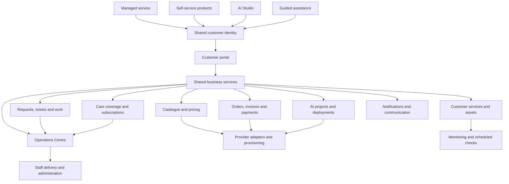

# HostSuite Unified Platform Architecture

**Status:** Architecture baseline / implementation specification  
**Baseline audited:** `staging` at `2df2279e42dbf0c14d825e38d851ed2ea4014ab8`  
**Scope:** Customer journeys, application boundaries, current data model, shared services, permissions and implementation sequence.  
**Non-goals:** This document does not authorize schema migrations, production changes, branch merges, DNS changes or infrastructure changes.

**Technical foundation companion:** [Database Relationships and Security Audit](./DATABASE_RELATIONSHIPS_AND_SECURITY_AUDIT.md) records the migration-by-migration ownership/RLS review, API/service-role call-site audit, confirmed security findings and remediation gates. It distinguishes staging from the still-unmerged PR #58 schema proposal.

## 1. Product architecture decision

HostSuite is one managed-services-first platform with four customer entry points:

1. **Managed service — “You handle it.”** The customer describes a problem or outcome, discusses scope with HostSuite, receives an agreed quote, pays and tracks delivery.
2. **Self-service — “I'll do it.”** The customer discovers and purchases standard products such as domains, hosting and email, then manages supported resources.
3. **AI-powered — “Build with HostSuite AI.”** The customer creates and edits a website project, then can publish it using compatible hosting/domain services or request human assistance.
4. **Guided assistance — “Help me decide.”** HostSuite assesses the customer's need and routes them into the appropriate journey.

These are entry points, not separate businesses, portals, identity systems or billing systems.

**Primary product promise:** HostSuite can act as the customer's technical team. Self-service and AI increase customer choice; they do not prevent the customer from moving into managed support.

## 2. Target logical architecture

The diagram is a target boundary map, not a claim that all connections already exist.

## 3. Existing application surface (staging audit)

### Customer-facing routes

| Route | Observed role | Current assessment |
|---|---|---|
| `/` | Public marketing and diagnostic entry | Preserve approved homepage and existing lead/WhatsApp flow |
| `/get-started` | Entry redirect | Currently redirects to `/portal/hosting`; not yet a guided decision flow |
| `/domains` | Public domain search/discovery | Search API exists; registration checkout journey needs connection |
| `/hosting` | Public hosting information | Not yet a complete public catalogue-to-checkout journey |
| `/portal` | Authenticated portal entry | Shared authenticated portal |
| `/portal/dashboard` | Customer overview | Existing central dashboard |
| `/portal/domains` | Customer domain view | Existing portal surface |
| `/portal/hosting` | Customer hosting view | Existing portal surface |
| `/portal/email` | Customer email view | Existing portal surface |
| `/portal/services` | Purchased service instances | Existing service-instance view |
| `/portal/managed-assets` | Customer-owned/external assets | Separate from HostSuite-provisioned instances |
| `/portal/websites` | Website records | Website management surface exists; deployment integration needs validation |
| `/portal/website-builder` | AI website projects | Generation/project surface exists; full publish lifecycle incomplete |
| `/portal/support` | Customer support | Persistent ticket experience is being extended in PR #58 |
| `/portal/billing` | Orders/invoices/billing | Existing billing surface; quote checkout is in PR #58 |
| `/portal/monitoring` | Monitoring display | UI exists; do not represent it as live scheduled monitoring without operational evidence |

### Admin and operations surface

The current admin area includes Operations, service-instance administration, Lead Inbox, ticket administration, content, blog and knowledge-base panels. Keep the existing Operations Centre as the staff workspace. Consolidate overlapping routes only after mapping permissions and actions; do not build a parallel admin portal.

### Existing service-discovery component

`components/service-discovery.tsx` contains the customer choices “I'll do it”, “You handle it” and “Guide me”. The component is not yet a complete workflow router. Reuse its intent model and connect each choice to an actual route/action; do not discard it or leave it as a decorative selector.

## 4. Current data foundations and intended ownership

| Existing table / model | Current responsibility | Architectural treatment |
|---|---|---|
| `auth.users` | Supabase authentication identity | Canonical login identity |
| `leads` | Public diagnostic/pricing/manual enquiries | Pre-customer or pre-ticket intake; retain source and contact history |
| `support_tickets` | Customer requests and staff work queue | Canonical support/work request record; PR #58 extends diagnostic linkage and quote fields |
| `domains` | Legacy customer domain inventory | Treat as legacy/compatibility data; avoid creating new duplicate inventory without a migration plan |
| `billing_products` | Product catalogue and billing mode | Shared catalogue for standard products and eligible service products |
| `billing_price_versions` | Price history/supplier economics | Pricing governance; preserve historical price evidence |
| `billing_orders` | Customer purchase/order record | Shared order ledger for standard purchases and custom quote settlement |
| `billing_order_items` | Order line items | Immutable purchased line details |
| `billing_invoices` | Customer invoice record | Shared invoice ledger |
| `billing_subscriptions` | Subscription records | Shared subscription record; recurring collection lifecycle still requires verification/completion |
| `billing_entitlements` | Purchased customer value/rights | Separate from payment status; use to represent grantable product value |
| `billing_webhook_events` | Provider webhook idempotency/audit | Server-owned event ledger |
| `service_instances` | HostSuite-purchased/provisioned resources | Canonical operational record for services provisioned through HostSuite |
| `provisioning_attempts` | Provisioning execution history | Preserve retries, failures and provider outcomes |
| `managed_assets` | Existing customer-owned/external services | Canonical record for assets HostSuite is asked to manage, including third-party-hosted assets |
| AI project records | Customer-owned AI website projects and generation state | Keep project ownership separate from published website/service records |
| AI usage records | Generation/usage accounting | Keep usage metering separate from service ownership and payment state |

### Important distinction: service instances versus managed assets

- A **service instance** is a product/service HostSuite has sold and provisioned or is responsible for provisioning.
- A **managed asset** is an asset the customer already owns or operates, which HostSuite may manage regardless of where it is hosted.

The customer portal may present both under a common “My services” experience, but the database must retain their different lifecycle, provider and ownership semantics.

### Data model rules

1. One authenticated customer identity owns the customer's profile, tickets, orders, invoices, subscriptions, AI projects and asset relationships.
2. Do not use email address as the durable foreign key between customer records. Resolve account ownership to the authenticated user ID.
3. A diagnostic lead may exist before account creation. Conversion must preserve the lead and link it to the correct customer/ticket; do not erase the intake record.
4. One diagnostic conversion creates one ticket. A later diagnostic creates a separate ticket under the same account. Related requests can be linked without merging their histories.
5. An order records a commercial transaction; an entitlement records what the customer is allowed to use; a service instance records the operational resource. These are not interchangeable.
6. A ticket is a work request, not a purchased service. A paid ticket quote does not automatically create a subscription or hosting service.
7. A customer may own multiple assets but subscribe to care coverage for only explicitly listed assets and limits.
8. Third-party supplier charges must remain separately identifiable from HostSuite labour/managed-service charges.

## 5. Shared service boundaries

### Identity and access
- Supabase Auth remains the identity provider.
- Customer data is owner-scoped by authenticated user ID.
- Staff/admin operations use explicit server-side role verification and service-role access only in trusted server code.
- Never trust customer-supplied user IDs, quote amounts, order totals, payment state, role or entitlement claims.

### Catalogue and pricing
- Standard domain/hosting/email products use the shared catalogue and server-side price calculation.
- Negotiated technical work uses a versioned quote attached to a ticket.
- Care plans are coverage products with explicit included assets, limits, task frequency, exclusions and support scope.
- Third-party costs are not discounted as if they were HostSuite labour.
- Price changes must not rewrite historical order or paid quote values.

### Orders, payments and entitlements
- Standard purchases, negotiated quotes and subscriptions use shared billing primitives but separate purchase rules.
- The server calculates order totals. The browser may request a product/quote identifier but cannot choose the payable amount.
- A payment return URL is not proof of payment. Provider verification/webhooks are authoritative.
- Verify provider, reference, amount, currency, order ownership and relevant quote revision before settlement.
- Webhook handling must be idempotent and safe under retries/concurrent delivery.
- Payment success and service provisioning are distinct states. A paid order can have a provisioning failure requiring retry/reconciliation.
- Recurring collection requires explicit customer consent and a verified provider authorization lifecycle; a subscription row alone does not prove automatic collection is operational.

### Requests, tickets and work
- Public diagnostics create leads and preserve the WhatsApp handoff.
- Staff can convert a lead into a ticket after account matching and agreement.
- Ticket lifecycle should include: new/requested → triage → quote pending/awaiting payment → paid/ready for work → assigned/in progress → awaiting customer/review → completed/closed (with cancellation/refund paths where applicable).
- Store scope, customer-visible updates, internal notes, assignment, evidence/deliverables and timestamps as distinct concepts.
- One-off work remains available without a care subscription.
- Subscription coverage does not mean unlimited future work; uncovered work can receive a separate quote.

### Services, assets and provisioning
- Product checkout creates an order.
- Verified payment grants the applicable entitlement and initiates provisioning where relevant.
- Provisioning uses provider capability adapters and records attempts/outcomes.
- Existing external assets can be added to managed-assets records without pretending HostSuite sold or provisioned them.
- Publishing an AI site must create or link a durable website/deployment asset and, where applicable, the relevant hosting/domain service records.

### AI Studio
- AI project ownership remains tied to the customer account.
- Draft/generation state is distinct from published deployment state.
- Publishing must validate target compatibility, ownership, domain/hosting entitlement and deployment outcome.
- Customers must be able to request human help from an AI project without creating a disconnected customer identity or losing project history.

### Monitoring and care
- Monitoring UI and monitoring execution are separate. A displayed status is only as reliable as its latest recorded check.
- Scheduled checks should run in a worker/provider outside ordinary web requests, with timestamped results and alert handling.
- Unknown/missing/stale results must not be represented as healthy.
- Care coverage defines which assets and tasks HostSuite is responsible for, and how frequently each task is performed.
- Do not publish uptime, backup, response-time or SLA promises until operational evidence and delivery capacity support them.

## 6. Four customer journeys and shared records

### A. Managed service
1. Customer selects a need or submits a diagnostic.
2. Public diagnostic saves a lead and opens WhatsApp with context.
3. HostSuite discusses and agrees scope, amount and delivery expectations.
4. Customer signs in or creates an account.
5. Staff links the lead to that account and converts it to a ticket.
6. Staff creates/updates an immutable quote revision.
7. Customer pays through server-calculated checkout.
8. Verified payment settles the quote/order/invoice.
9. Staff assigns and performs the work; customer sees progress and deliverables.
10. Ticket closes with work history retained. Future diagnostics create new tickets.

### B. Fixed-price domain/hosting/email
1. Customer browses public catalogue and searches availability where applicable.
2. Customer selects a product and signs in.
3. Server calculates price and creates order/invoice.
4. Customer pays through supported provider.
5. Webhook verifies and settles payment.
6. Entitlement and service instance are created; provisioning runs and records outcome.
7. Customer sees service status, controls and renewal information in the same portal.
8. Customer can request managed setup/support at any time.

### C. AI website creation
1. Customer starts an AI project under their account.
2. Generation creates a draft and usage record.
3. Customer edits/previews the draft.
4. Publishing checks domain, hosting, ownership and deployment prerequisites.
5. Successful deployment creates/links a published website asset.
6. Customer can manage it independently or request HostSuite-managed care.

### D. Guided assistance
1. Customer describes their goal and technical comfort.
2. HostSuite recommends managed service, self-service or AI.
3. The chosen path opens the corresponding journey with the assessment context retained.
4. If customer cannot complete the journey, the same account can request human assistance.

## 7. Security and data-governance findings to resolve

The original schema migration documents broad public/anonymous read access to `leads`, including contact details. The PR #58 branch proposes tightening lead reads to admin-only. That change is important, but it must be reviewed against all admin/service-role usage before applying migrations.

Before new customer journeys are opened:
- Review every table's RLS policies against customer, staff, admin, service-role and anonymous actors.
- Audit all service-role key usage; keep it server-only.
- Validate customer ownership on every order, ticket, asset, AI project and checkout route.
- Ensure client-side code cannot set staff-only ticket, quote, order, invoice or provisioning fields.
- Ensure webhook signatures and provider transaction verification are both checked.
- Add idempotency and concurrency tests for payment settlement and provisioning.
- Do not expose internal notes, provider credentials, supplier costs or other customers' data.

## 8. Known gaps and decisions

| Gap | Required decision/work |
|---|---|
| Service discovery is not a complete router | Connect each choice to a supported route and persist relevant intent |
| `/get-started` is a redirect | Replace only after destination journeys are ready |
| Public hosting catalogue/checkout incomplete | Decide product catalogue visibility and connect to existing order API |
| Domain registration purchase flow incomplete | Connect availability → authenticated order → payment → provider registration |
| Legacy `domains` versus `service_instances` | Define read/write ownership and a non-destructive migration/compatibility plan |
| `managed_assets` versus purchased services | Present together in UI while retaining separate lifecycle models |
| Ticket delivery lifecycle | Add assignment, customer updates, evidence/deliverables and closure history |
| AI deployment | Define provider/deployment contract and link published sites to assets/services |
| Recurring subscriptions | Verify authorization, automatic charge, retry, dunning, cancellation and renewal before promising auto-renewal |
| Monitoring | Implement scheduled checks, durable results, alerting and stale/unknown handling |
| Care coverage | Define asset limits, task frequency, exclusions, SLA and add-on pricing |
| Operations Centre overlap | Map routes/actions/roles, then consolidate without losing staff workflows |

## 9. Implementation roadmap

### Gate 0 — Complete PR #58
- Confirm latest CI and review migration/RLS and webhook settlement logic.
- Exercise customer/admin quote flows and payment edge cases.
- Keep migrations unapplied until schema review and explicit approval.

### Gate 1 — Architecture and data contracts
- Adopt this document as the baseline.
- Produce a table-by-table relationship/RLS matrix from the complete migration history.
- Define the canonical service/asset read model and ownership rules.
- Define route/API contracts for the four customer journeys.
- Do not create duplicate tables before this design is approved.

### Gate 2 — Service discovery and managed-service delivery
- Connect “I'll do it”, “You handle it” and “Guide me” to actual journeys.
- Complete ticket assignment, customer communication and work-delivery history.
- Preserve the public diagnostic/WhatsApp handoff.

### Gate 3 — Fixed-price commerce
- Complete public domain/hosting catalogue and authenticated checkout.
- Connect order → verified payment → entitlement → service instance → provider provisioning.
- Add retry and customer-visible provisioning state.

### Gate 4 — AI-to-service lifecycle
- Complete editor/preview/publish.
- Link deployment to customer website asset, domain and hosting records.
- Allow transition from self-service AI to managed service.

### Gate 5 — Care subscriptions
- Define coverage and task schedules.
- Implement explicit recurring authorization, collection, retries, renewal, cancellation and customer controls.
- Keep one-off work separately billable.

### Gate 6 — Operations and infrastructure
- Consolidate staff workflows.
- Design monitoring/backup execution and alerting.
- Then audit Cloudflare, Supabase, secrets, backups, environments, deployment and recovery.

## 10. Change-control boundaries

- Keep the approved homepage unchanged.
- Do not modify or merge PR #42 or PR #57 as part of this work.
- Do not merge PR #58 without explicit approval.
- Do not apply Supabase migrations without explicit approval.
- Do not change `main`, production deployments, DNS or Cloudflare configuration without explicit approval.
- Make each implementation stage on a focused branch/PR and validate before proceeding.

## 11. Acceptance criteria for the unified platform

The architecture is materially achieved when:
- A customer can enter through any of the four routes and end up in the same account.
- A customer can own purchased services and external managed assets together without duplicate identity or confusing lifecycle.
- A diagnostic becomes a durable ticket with agreed quote and verifiable payment.
- Fixed-price purchases use server-calculated prices and verified provider settlement.
- AI projects can become published website assets linked to domain/hosting.
- A customer can switch from self-service/AI to human-managed support without restarting.
- Care coverage clearly identifies which assets/tasks are included.
- Staff can operate the same customer, ticket, asset and billing records from one Operations Centre.
- No customer-facing reliability promise exceeds measured operational capability.
